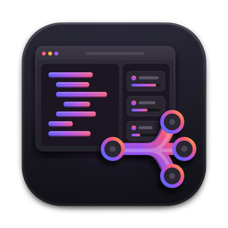
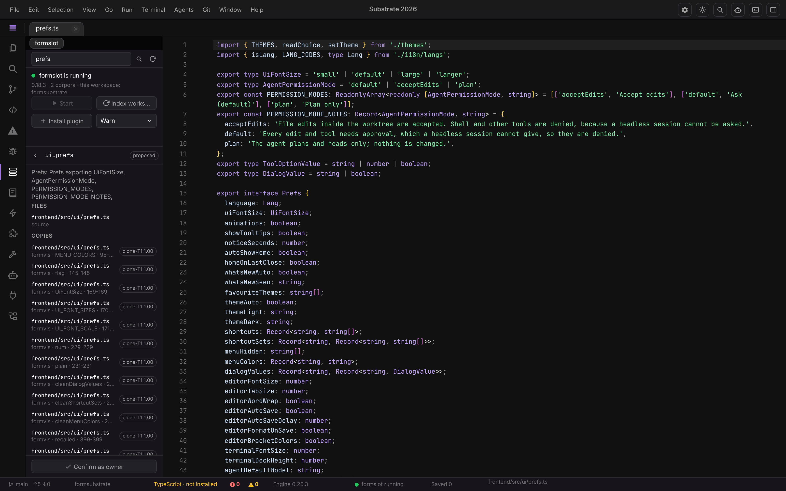
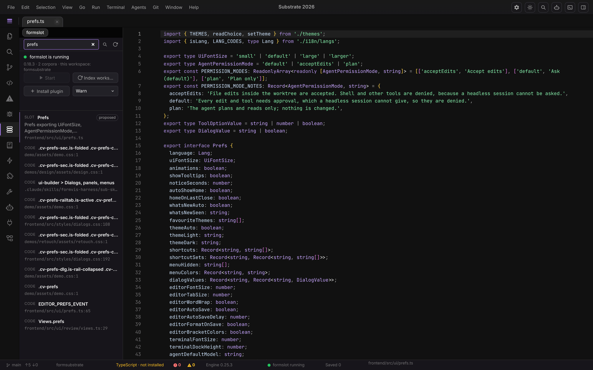
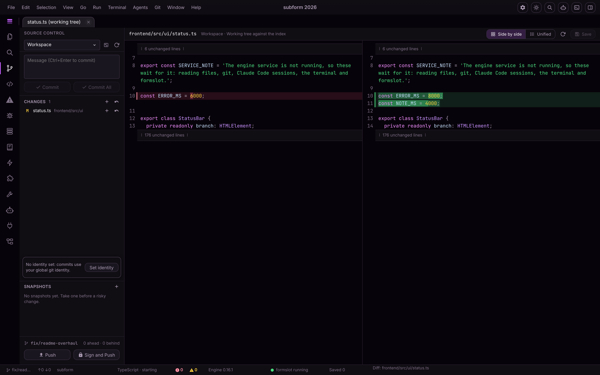
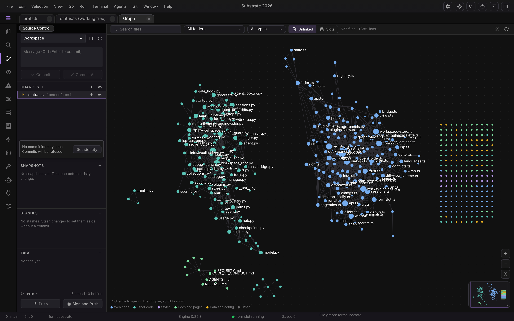

<p align="center">
  
</p>

<h1 align="center">FormSubstrate</h1>

<p align="center">
  <b>FormSubstrate - instead of VS Code: the code &amp; text editor from the FormAI family of apps, with Claude Code agents built in.</b><br>
  The application is called Substrate (<code>Substrate.app</code>). It runs several Claude Code agents at once,<br>
  each in its own git worktree; you review their changes hunk by hunk, with what FormSlot already knows shown before an agent writes.
</p>

<p align="center">
  
  
  
  
  
  
</p>

<p align="center">
  <a href="https://formai.studio/"><b>Download Substrate on formai.studio</b></a> ·
  <a href="#run-it-from-source">Run it from source</a>
</p>

<p align="center">
  
  <br>
  <sub>The editor on Substrate's own source, with the FormSlot panel showing a slot and its copies.</sub>
</p>

<p align="center">
  <a href="#features">Features</a> ·
  <a href="#everything-in-the-box">In the box</a> ·
  <a href="#built-for-agents">Agents</a> ·
  <a href="#under-the-hood">Under the hood</a> ·
  <a href="#download">Download</a> ·
  <a href="#run-it-from-source">Run from source</a>
</p>

<table>
  <tr>
    <td width="25%" valign="top">
      <h3>Agents in worktrees</h3>
      Claude Code sessions each get their own git worktree, so several agents work on one repository without stepping on each other.
    </td>
    <td width="25%" valign="top">
      <h3>Review before commit</h3>
      Accept or reject an agent's changes hunk by hunk, send comments back to the session, and commit under your own identity.
    </td>
    <td width="25%" valign="top">
      <h3>FormSlot gates</h3>
      An agent about to rewrite code that already exists pauses until you choose to use it, adapt it or write new.
    </td>
    <td width="25%" valign="top">
      <h3>Agent-ready</h3>
      An MCP server with 14 tools lets an agent read the workbench's sessions, review, terminals, graph runs, gate notes, FormSlot slots and language-server problems.
    </td>
  </tr>
</table>

## Features

<table>
  <tr>
    <td width="50%" valign="top">
      
      <br><sub>Search slots, code and decisions from the side panel.</sub>
      <h3>FormSlot in the editor</h3>
      A status item, a slots panel with search and manifests, and provenance badges in review show what already exists.
    </td>
    <td width="50%" valign="top">
      
      <br><sub>Source Control with a side-by-side diff of a working-tree change.</sub>
      <h3>Git and review</h3>
      Stage, diff, snapshot and rewind, then commit with trailers stripped and every commit audited. Push and Sign and Push check each push.
    </td>
  </tr>
  <tr>
    <td width="50%" valign="top">
      
      <br><sub>The file graph of this repository: 413 files and 1139 links.</sub>
      <h3>File graph</h3>
      See how a repository's files link to each other, filter by folder or type, and click a node to open the file.
    </td>
  </tr>
</table>

## Everything in the box

<table>
  <tr>
    <td width="33%" valign="top">
      <h4>Editor</h4>
      CodeMirror 6 · TypeScript and pyright language servers · Outline · Problems · editor split · Markdown preview · Python debugging with debugpy
    </td>
    <td width="33%" valign="top">
      <h4>Agents and git</h4>
      Claude Code terminals · headless chat runs · worktree sessions · hunk review · snapshots · commit audit · Studio graphs
    </td>
    <td width="33%" valign="top">
      <h4>Formats</h4>
      Opens: code, Markdown, images, video, audio, PDF · Saves: files in your workspace
    </td>
  </tr>
</table>

## Built for agents

Substrate's engine is an MCP server with 14 tools, 13 of them read-only. Only `review_comment` changes state, and no tool writes files, commits or answers a gate.

```sh
./formsubstrate mcp        # MCP server on stdio for Claude Code, Codex and Cursor
./formsubstrate doctor     # toolchain, installs and ports
```

The HTTP endpoint is `POST /mcp`, behind a local guard and a bearer token. It works inside Substrate sessions automatically, and for an outside client (Claude Code, Codex or Cursor) after you add the client in Preferences, Agents, MCP clients, which shows its token once. An outside client may read the open workspace, the session list and each session's status; it cannot write, comment, answer gates or read terminals. A routing skill pack for agents is in [`.claude/skills/formsubstrate-harness/`](.claude/skills/formsubstrate-harness/SKILL.md). See [`docs/MCP.md`](docs/MCP.md) and [`AGENTS.md`](AGENTS.md).

## Under the hood

- **Engine:** FastAPI on `127.0.0.1` behind a local guard; owner-only changes need the window token.
- **Window:** TypeScript and Vite 8 with CodeMirror 6, wrapped by a Tauri 2 desktop shell.
- **Terminals:** a detached pty-host keeps shells and Claude Code running through an engine restart.

## What Substrate sends over the network

Nothing leaves your computer unless you use a feature that needs it. Substrate collects no usage data: there is no telemetry, no crash reporting and no update check. The engine and the window talk to each other on `127.0.0.1` only.

- **The model provider you configure** (Cogentics). Chats, Test connection and the model price list go to the provider's address: OpenRouter by default, Ollama or LM Studio on this computer, or a custom address you enter. The price list is fetched only when a provider is configured. Requests to OpenRouter name Substrate in two headers.
- **The web search plugin.** When an agent or recipe runs it, the search words go to DuckDuckGo (`html.duckduckgo.com`).
- **The HTTP connector plugin.** Requests go to the address its settings name, only when it runs.
- **MCP servers you add.** An HTTP server gets requests at the address you gave, with the headers you saved. A command server runs on your computer and does whatever that program does.
- **git.** Clone repo fetches the address you enter (https and ssh only). Push runs `git push` to the remote you pick; Sign and Push runs `git fetch` and then `git push`. Nothing is fetched or pushed in the background.
- **Claude Code.** Sessions run the `claude` command found on your computer. Its traffic to Anthropic is Claude Code's own, under its own settings; Substrate does not see or relay it.
- **Language servers and debuggers** you installed run as your programs; what they download is up to them. The install commands Substrate shows are text for you to copy; it does not run them.
- **formslot** is reached on this computer only (`127.0.0.1`).
- **Links.** The desktop app opens an `http`, `https` or `mailto` link in your browser only when you click it.

## Download

| Platform | Download | Release |
|---|---|---|
| macOS | [Download Substrate for macOS](https://formai.studio/get/formsubstrate/macos) | [Substrate releases](https://github.com/nodemode-dev/formsubstrate/releases) |
| Windows | [Download Substrate for Windows](https://formai.studio/get/formsubstrate/windows) | [Substrate releases](https://github.com/nodemode-dev/formsubstrate/releases) |
| Linux | [Download Substrate for Linux](https://formai.studio/get/formsubstrate/linux) | [Substrate releases](https://github.com/nodemode-dev/formsubstrate/releases) |

All Substrate builds are compiled and signed by [FormCompiler](https://github.com/nodemode-dev/formcompiler), which drafts each release on this repository's own [Releases page](https://github.com/nodemode-dev/formsubstrate/releases); this repo holds the source. What changed in each version is in [CHANGELOG.md](CHANGELOG.md).

## Run it from source

Prefer it in your browser, or want to contribute? Run the web UI straight from this repo.
**Requires:** git, Python 3.13 or later, Node 20.19 or later, and Claude Code for agent sessions.

```sh
git clone git@github.com:nodemode-dev/formsubstrate.git
cd formsubstrate
./formsubstrate_oc_install     # backend venv and frontend packages
./formsubstrate                # engine on 127.0.0.1:5655, web UI at http://localhost:5650
```

`frontend/node_modules/.bin/tauri dev` opens the desktop window instead; `FORMSUBSTRATE_PORT` moves the engine port. On Windows use `formsubstrate_oc_install.bat` and `formsubstrate.bat`. New users can double-click `Install formsubstrate.command` or `Install formsubstrate.bat`. The guide is [`docs/GUIDE.md`](docs/GUIDE.md).

> [!IMPORTANT]
> **Status:** release. Signing and notarization of the desktop app, and the FormCompiler catalogue rows, are still the owner's steps. See [`docs/RELEASE.md`](docs/RELEASE.md).

**Contributing:** branch from `main`, keep changes to source here, and leave packaging and releases to formcompiler. See [`AGENTS.md`](AGENTS.md).

## Repository

| Path | What it is |
|---|---|
| `frontend/` | The window: TypeScript, Vite and CodeMirror |
| `backend/` | The FastAPI engine, MCP server, pty-host and presets |
| `src-tauri/` | The Tauri 2 desktop shell |
| `setup/` | Install, boot, doctor and freeze scripts |

## Maintainers

| Maintainer | Role |
|---|---|
| [@nodemode-ai](https://github.com/nodemode-ai) | Owner |
| [@gbarnai](https://github.com/gbarnai) | Co-owner |

Code owners are set in [`.github/CODEOWNERS`](.github/CODEOWNERS).

## License

FormSubstrate is licensed under the GNU General Public License v3.0 ([`LICENSE`](LICENSE), SPDX `GPL-3.0-only`). Copyright (C) 2026 NodeAgentc, Inc. Third-party notices: [`NOTICE.md`](NOTICE.md). Code ported from FormVis (Apache-2.0) and substrata (MIT) keeps its notices there.
